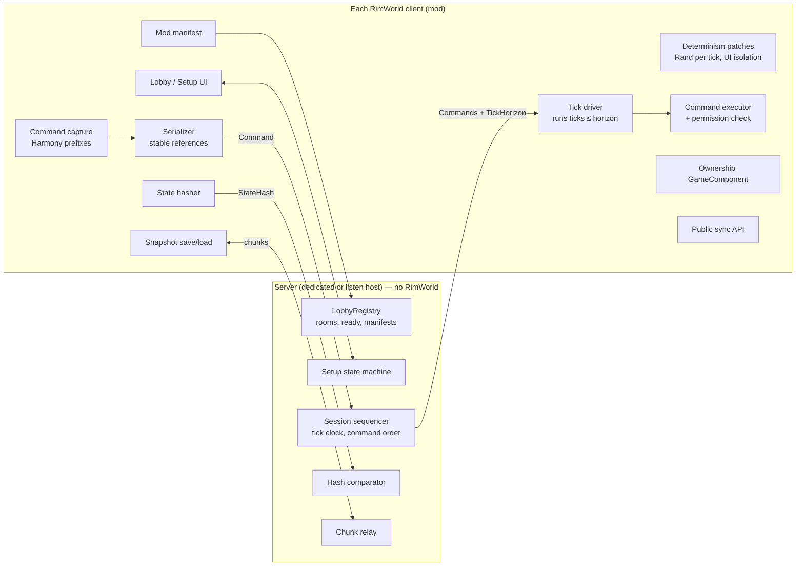
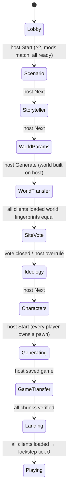
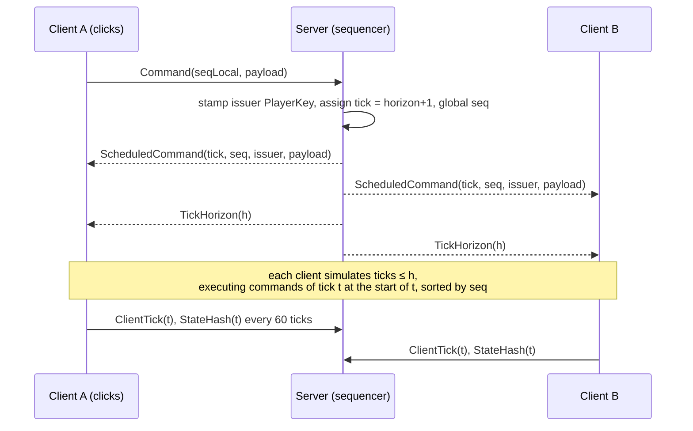

# RimworldMP — Full multiplayer plan

> **Self-contained hand-off document for humans and AI agents.** If this is the only file you have, you can still pick up a milestone. Everything you need is in here or linked by URL.
>
> - **Status:** draft plan, waiting for the owner's review. Nothing in Parts A–C is implemented.
> - **Version:** 1.1 · 2026-10-15 · author: claude (claude-opus-5-5). 1.1 renumbered the milestones to the repo's task-ID format (`XXX-001`) and added TOOL-001.
> - **Target code:** <https://github.com/858855/RimworldMP>, `main` @ `cb63a22`
> - **Target game:** RimWorld **1.6.4871** (Unity/Mono). Not 1.7 / Waylith.
> - **Location:** `docs/plans/rimworldmp-full-plan.md` in the GitHub repo. A copy lives in the planning repo `E:\claude` at `docs/design/`; that copy supersedes its earlier `new-game-setup.md`, now Parts A and B below.
> - **Task register:** every milestone in §10 has an entry with the same ID in `docs/ai/TASKS.yaml` (status `planned`).

---

## 0. How to use this file (read first, especially if you are an AI agent)

### 0.1 Rules you must follow

**Working in the GitHub repo `858855/RimworldMP`.** Its `AGENTS.md` (in German) is **binding** and overrides this plan where they conflict. The rules you'll hit most:

| Rule | Meaning |
|---|---|
| 4 | Write a one-page design note before code: goal, classes, state model, persistence, UI, network sync, conflicts, performance, tests, rollback |
| 5 | Check every RimWorld API against the **local installed** 1.6 assemblies by reflection. Never invent methods. Record results in `references/verified-apis.md` |
| 12–18 | Determinism rules: no `System.Random`, `UnityEngine.Random` or wall clock in gameplay; sort unordered collections; mutate state only from the tick or command path |
| 23 | Multiplayer features need tests with **two real RimWorld clients** (join, action, RNG, pause and speed, save/load, reconnect, a 30-minute run, state comparison) |
| 25 | Label every test result honestly: `XML_VALIDIERT`, `BUILD_ERFOLGREICH`, `IN_GAME_GETESTET`, `MP_ZWEI_CLIENTS_GETESTET` or `NICHT_GETESTET` |
| 29–30 | `docs/ai/PROJECT_STATE.yaml` is the current state; `docs/ai/TASKS.yaml` is the task register. Bigger tasks need a contract: goal, scope, non-goals, dependencies, acceptance, tests, risks, branch |
| 31–32 | Work only on branches and use Conventional Commits. **Never merge or push without explicit human approval** |

**Working in the local planning repo `E:\claude`.** Follow `ai/README.md` there: read `PROGRESS.md`, `TODO.md` and the latest reports; claim an item; write a session report.

### 0.2 How to pick work

1. Find the first milestone in [§10](#10-milestones) whose dependencies are `done` and that isn't claimed.
2. Its entry already exists in `docs/ai/TASKS.yaml` with the same ID. Before coding, extend that entry into a full contract ([Appendix A](#appendix-a--task-contract-template)): scope, non-goals, tests, risks, branch. Then set `implementation: in_progress`.
3. Start with **its** verification items. Most milestones begin by checking RimWorld APIs that this plan only names as candidates.

### 0.3 Evidence tags used in this file

| Tag | Meaning |
|---|---|
| **[V]** | Verified in repo code at `cb63a22` (file and line given) |
| **[R]** | From the repo's own research notes (`research/07–11`), which cite `rwmt/Multiplayer` sources; prior art, not our code |
| **[A]** | Design assumption or proposal; needs owner approval or a test |
| **[U]** | RimWorld API name that is **not verified**; check it by reflection before use |

---

## 1. Where the project stands today

| Area | State at `cb63a22` |
|---|---|
| Protocol | Binary frames, **wire version 2**, max body **65 536 bytes** (`FrameCodec.MaximumBodyLength`) [V]. 19 message types, from Hello up to lobby chat [V] |
| Network | TCP (dual-stack `::`, DNS, IPv4/IPv6 fallback) or an injected duplex stream; one reader; serialized sends; handshake deadline [V] |
| Lobby | `LobbyRegistry`: in-memory rooms, host role, ready flag, revisions, all under one lock. The host role moves to the first remaining member when the host leaves (`Leave`) [V] |
| Hosting | One `FoundationServer` core, used by the **dedicated Linux server** and by the **listen host** inside RimWorld. Heartbeat with nonces [V] |
| Transports | IP/TCP with UPnP and reachability display; **Steam P2P** (friends lobby, `SteamPeerStream`, receive queue capped at 1 MiB) [V] |
| RimWorld mod | "Multiplayer" button in the main menu after Tutorial (Harmony prefix); connection window; lobby with ready/leave/close; chat. At `FoundationMod.cs:392` it shows `Spielstart nicht verfügbar (Version 0.1)` [V] |
| Identity | Per-connection session `Guid` only. There is **no persistent player identity** [V] |
| Gameplay | **None.** No setup, no save transfer, no sync. v0.1 spec: "a start button must not pretend to be a finished feature" (`docs/SPEC.md`) [V] |
| Known gaps | No auth or TLS on IP lobbies; chat with two game clients not yet tested in-game; 1.7 unsupported [V] |

GitHub repo roadmap (`docs/roadmap.md`): 0.2 extensible messages and sessions · 0.3 session foundation and shared saves · 0.4 experimental gameplay commands · 0.5 determinism and desync prototype · 1.0 playable gameplay multiplayer. This plan fills in those versions.

> **Note on two repos.** `E:\claude` (a 36-task roadmap, decision D-001 "core from scratch") and `858855/RimworldMP` share **no git history**. This plan targets the GitHub code. The task IDs from the local roadmap are mapped in [§10](#10-milestones). Which repo is the source of truth is open question Q6.

---

## 2. Goal of version 1.0

**Product goal.** Two to four players [A] play **one shared colony** in RimWorld 1.6. They start a new game together from a lobby, or resume a saved multiplayer game. Each player controls their own pawn or pawns. Time is shared. Players can join and reconnect mid-game. Desyncs are detected, explained and repaired without restarting.

**In scope for 1.0**
- Lobby checks (mods and load order) and a Start button
- Shared new-game setup: scenario, storyteller, world, site vote, ideoligion, characters
- **Deterministic lockstep gameplay sync** for vanilla and all official DLCs, in tiers
- Pawn ownership and permissions
- Coordinated saves; join, reconnect and resume
- Desync detection, diagnostics and recovery
- A public sync API for mods, and a tested mod matrix
- Steam P2P, IP/TCP and the dedicated server

**Out of scope for 1.0** (later phases)
- Several player factions or colonies in one world, diplomacy between players, PvP (local roadmap phases 5–6)
- Separate time per map ("async time")
- RimWorld 1.7
- Mixed game versions
- Installing mods automatically

---

## 3. Architecture

### 3.1 Core decision: deterministic lockstep, with the server as sequencer [A]

Every RimWorld client simulates the **whole game** itself. Only **player commands** go over the network. The server gives each command a global order and a **tick**. No client simulates past a tick until it has every command for that tick. Same start save + same commands in the same order + same random numbers ⇒ the same state everywhere.

**Why lockstep, not sending state:**

| | Lockstep (chosen) | Host simulates, sends state |
|---|---|---|
| Bandwidth | tiny (commands only) | huge: a RimWorld map has tens of thousands of Things |
| Server | needs no RimWorld, so the existing Linux dedicated server works unchanged | needs a full game instance |
| Main cost | **determinism**: every source of randomness or local mutation must be controlled | serializing and applying state, plus interpolation |
| Prior art | `rwmt/Multiplayer` uses lockstep for RimWorld [R] | none known for RimWorld |

**Consequence.** The server never runs RimWorld code. It orders commands, runs the tick clock, compares state hashes and relays big transfers. The **host player** is an admin and the **snapshot provider**, meaning the client whose save counts as the reference. Any client can take that role over, because every client holds the full state.

### 3.2 Components



**Projects** (follows the existing layout at `src/`):

| Project | Gets |
|---|---|
| `Multiplayer.Foundation.Protocol` | Wire v3 (lobby/setup) and v4 (session) messages, plus the `SyncWriter`/`SyncReader` primitives |
| `Multiplayer.Foundation.Lobby` | Room phase, manifest status, vote tally, pawn slots |
| `Multiplayer.Foundation.Session` (**new**, `netstandard2.0`, no Verse) | Sequencer, tick clock, flow control, hash comparison, chunk relay. Unit-testable without the game |
| `Multiplayer.Foundation.Hosting` | Wires the session into `FoundationServer` |
| `Multiplayer.Foundation.RimWorld` | Everything that touches Verse: UI, manifest, setup hooks, capture, executor, determinism patches, snapshots, ownership |
| `Multiplayer.Foundation.Api` (**new**, small, stable) | The public sync API for other mods (§7.10) |

Rule (as in the repo today [V]): network libraries never reference Verse or Unity.

---

## 4. Roles and identity

| Role | Is | Can |
|---|---|---|
| **Server** | dedicated process, or the listen host's embedded server | order commands, stamp the issuer on each command, gate ticks, compare hashes, relay chunks, enforce lobby and setup rules |
| **Host** | the player with admin rights (`Room.Host`) | Start, host-only setup steps, overrule the site vote, set speed policy and permissions, kick, save; acts as **snapshot provider** |
| **Player** | any member | own pawns, colony actions allowed by permissions, votes |

**PlayerKey** [A] is a new, persistent identity: the SteamID on Steam, otherwise a GUID created once and stored in mod settings. It is sent in `Hello`. Everything saved (ownership, permissions) uses the PlayerKey, never the session `Guid`. On the IP transport the key can be faked, because there is no auth (known gap; see risks).

---

## 5. Part A — Lobby: mod check and Start button

### 5.1 Mod and load-order check

Every peer must have the same game build, DLCs and mods **in the same order**. Otherwise the transferred world and save, and every later tick, will differ.

**The manifest.** Each client builds it once at game start on a background thread, and caches it by path, size and modified time.

| Field | Candidate source [U] | Must match |
|---|---|---|
| Game version with rev | the runtime version string, e.g. `1.6.4871 rev600` | **information only** (owner decision 2026-10-15): shown, not part of the checksum |
| Multiplayer mod version | this mod's assembly version | exact |
| Active mods **in load order**: package id (lower-case), name, `About.xml` version | the active mods list. Core and DLCs are entries in it | same ids, same order |
| Content hash per mod | SHA-256 over the relative paths and bytes of `About/About.xml`, `Assemblies/**/*.dll`, `Defs/**/*.xml` and `Patches/**/*.xml` in the load folders actually used for 1.6. Textures and sounds are skipped | exact |
| Manifest hash (the lobby checksum) | SHA-256 over the mods only: package ID, version and content hash, in load order. Not the game version, not display names | quick comparison |

**Flow**
1. **Lobby list:** shows the host's `game version · N Mods · a3f9…` and the viewer's own hash, so a mismatch is visible before joining.
2. **Join:** after `JoinLobby`, the client sends `ModManifest`. A large list goes through the chunk channel (§6.4).
3. **Reference = the current host's manifest.** The server compares hashes only (it never parses mods). It sets `PlayerView.ModStatus` to `Checking`, `Match` or `Mismatch`. If the host role moves, everyone is compared again.
4. **On mismatch:**
   - The player's line shows `– Mods abweichend` in red.
   - **Bereit** is disabled, and the server rejects Ready with the code "Mods stimmen nicht mit dem Host überein".
   - **"Unterschiede anzeigen"** fetches the host's list (`ModManifestRequest`) and shows a report with these sections: *Fehlt bei dir* (with Workshop links), *Zusätzlich bei dir*, *Falsche Reihenfolge* (side by side from the first difference), *Andere Version/Inhalt*, and the game version as a note only.
   - The player can stay in the lobby and chat. Fixing mods needs a restart.
5. **Start re-check:** the server checks again on Start.

### 5.2 Start button

`FoundationMod.DrawLobby` replaces the "Spielstart nicht verfügbar" label (line 392 [V]):

- **Host view:** a **"Spiel starten"** button. It is enabled only when all conditions below hold; otherwise one line shows the first failing reason.

  | Condition | Reason text |
  |---|---|
  | ≥ 2 players | `Mindestens 2 Spieler nötig` |
  | everyone's mods `Match` | `Mods stimmen nicht überein: <Name>` |
  | no one `Checking` | `Mod-Prüfung läuft …` |
  | everyone ready, host included | `Warte auf Bereitschaft: 2/3 bereit` |
  | host is in the main menu | `Nur im Hauptmenü möglich` |

- **Other players:** a status line, `Warte auf den Host …` or `Alle bereit – der Host kann starten`.
- **On click:**
  1. Confirmation: `Spiel mit N Spielern starten? Die Lobby wird gesperrt.`
  2. `StartSetupRequest` goes to the server, which re-checks under the registry lock, sets the room phase to `Scenario`, **locks** the room (joins get "Spieleinrichtung läuft", the list shows `[Einrichtung]`), and broadcasts `SetupPhaseChanged`.
  3. The host's window closes and the vanilla scenario page opens, with chat docked in a small panel.
  4. Clients switch to the **Setup view**.
- **Resume a saved multiplayer game** (later milestone SAVE-002): the host gets **"Spielstand laden"** next to Start. It skips Part B and goes straight to game transfer (§6.3).

---

## 6. Part B — Shared new-game setup

### 6.1 Steps and who decides

| # | Vanilla page (screens seen in 1.6) | Decides |
|---|---|---|
| 1 | Choose scenario | Host [A] |
| 2 | Choose AI storyteller + difficulty (Custom…, Anomaly settings, reload/commitment mode) | **Host only** |
| 3 | Create world: seed, coverage, rainfall, temperature, population, landmarks, pollution, factions | Host [A]. The world is **generated on the host and sent to clients** |
| 4 | Select starting site | **Vote by all players; the host can overrule** |
| 5 | Choose ideoligion | Host [A] (one shared faction) |
| 6 | Create characters | **Each player picks the pawn they control**; the host starts |
| 7 | Game start | The host generates the game; everyone loads the same save; then lockstep starts |

### 6.2 Setup state machine (server)



**Abort** can happen in every state and returns to the Lobby. Causes: the host cancels or disconnects, a fingerprint doesn't match, or a timeout runs out. Ready flags are cleared and generated state is thrown away. **The host role must not move to another player during setup**, because only the host holds the generated state. This changes today's `LobbyRegistry.Leave` behaviour [V].

### 6.3 Step details

**Host-only steps (1, 2, 3, 5).**
- Harmony postfixes on each page's Next/Generate [U] read the values and send a `SetupSettings` revision. It contains the scenario, storyteller, difficulty (every field when Custom), Anomaly settings, commitment flag, world parameters, factions and ideo choice.
- Clients see the values live in the Setup view. If the host goes Back, a new revision is sent.

**World transfer (3 → 4).**
- Vanilla world generation runs **on the host only**. Before the site page opens, the host saves the world with Scribe [U], gzips it, and sends `WorldTransferBegin` (size, SHA-256, chunk count) followed by the chunks.
- Each client verifies the hash and loads the world into a minimal game using the host's scenario and storyteller. It then reports `WorldLoaded(fingerprint)`. The fingerprint hashes tile biome, hilliness, elevation, rivers, roads and faction bases.
- A different fingerprint means a mod difference the manifest missed, so setup aborts with a report. The timeout is 3 minutes per client; the host can keep waiting or drop that player.
- *Fallback if a world with no maps can't be saved and loaded (VER-001 checks this):* send the seed and parameters, let each client generate the world, and compare fingerprints. That is only safe because of §5.1.

**Site vote (4).**
- Everyone sees the vanilla world map and casts **one vote** on a valid tile. The host re-checks the tile with vanilla's settle rule [U].
- Votes appear as coloured markers with player names, plus a tally panel.
- The vote closes when everyone has voted and the host confirms, or when the timer runs out (default **90 s**) [A].
- Winner: most votes. A tie goes to the host's tile, otherwise the lowest tile ID.
- **Overrule:** "Diesen Ort erzwingen" lets the host end the vote at any time. Everyone sees "Host hat X gewählt (Abstimmung überstimmt)".

**Characters (6).**
- Pawn count = `max(scenario count, players)` [A]. Every pawn is generated **on the host**, using vanilla start-pawn generation [U].
- There is one shared window for all players, laid out like the vanilla page: Selected / Left behind, a pawn card, Team skills, plus an **owner badge** on each slot.
- Each player can **claim**, **re-roll**, **swap with left-behind**, or **rename** their own pawn, then press **Ready**. Each action is a `PawnRequest`. The host's game carries it out (random rolls happen only there) and broadcasts `PawnRosterState`. Requests from non-owners are rejected.
- The host can reorder pawns, assign owners, edit unowned pawns and force-start. On force-start, players without a pawn get a random free one. Unowned pawns are **shared**.
- Clients see pawn **cards**: names, age, xenotype, backstories, traits, skills and passions, incapable-of, health, relations, possessions. Portraits come later.

**Game transfer and landing (7).**
- The host runs the vanilla start sequence, adds the `MultiplayerSession` and `MultiplayerOwnership` components (§7.7, §7.8), saves, gzips and sends the save.
- Clients verify, load and report `ClientLoaded(sha256)`. The game stays **paused at tick T0** until all have loaded. Then the server starts the session clock (§7.1).

### 6.4 Chunk channel (shared by manifest, world, game and join snapshots)

- One transfer at a time per lobby. Frames are ≤ 60 KiB (the frame limit is 64 KiB [V]).
- `TransferBegin` → `TransferChunk` × n → the receiver sends `TransferAck(highest index)` every 16 chunks.
- The sender keeps at most 32 chunks unacknowledged. This back-pressure is needed for Steam's 1 MiB receive queue [V].
- Size caps: manifest 4 MiB, world 64 MiB, game or snapshot 256 MiB [A].
- The server relays chunks and keeps no full copy. For joins it keeps a copy only until the joiner has acknowledged all chunks.
- SHA-256 of the whole file is checked at the end; a mismatch means retry once, then abort.

---

## 7. Part C — Gameplay sync

### 7.1 Lockstep loop



- **Tick clock.** The server advances a target tick at the session speed: 1× = 60 ticks/s, 2× = 180, 3× = 360 [U, vanilla values to verify]. About every 50 ms it sends `TickHorizon(h)`, meaning "you may simulate up to tick h".
- **Ordering guarantee.** The server sends every `ScheduledCommand` for tick t **before** any horizon ≥ t. TCP and Steam reliable messaging keep that order. So a client never runs tick t without all of t's commands.
- **Scheduling.** A command received while the horizon is h gets tick `h + 1`. Input delay is then about RTT/2 plus up to one horizon interval. Target ≤ 250 ms at 100 ms RTT [A]. Locally the UI shows "pending" feedback (a ghost designation, a cursor tick) so clicks feel answered.
- **Flow control.** Each client reports `ClientTick` about 10 times per second. The server never moves the horizon past `min(ClientTick) + maxLead`, with maxLead about 2 s of ticks [A]. So **the slowest client sets the pace**. The UI shows `Warte auf Player3 (120 Ticks zurück)`. A client more than 30 s behind for more than 60 s gets a host prompt: wait, or kick and let them rejoin.
- **Tick driver** [U] (client). Patch the vanilla tick manager so that:
  1. ticks advance only while `localTick < horizon`;
  2. up to K ticks run per frame to catch up, with K bounded by frame budget;
  3. the vanilla speed buttons send **commands** instead of changing speed locally.
- **Pause and speed** are commands: `SetSpeed(speed)` and `SetPause(bool)`. Default policy: anyone may pause, and the host sets speed. Alternatives the host can pick: "lowest wish wins", or "host only" [A]. Pausing stops the horizon. Visual and UI work keeps running locally.
- **Forced pauses.** Vanilla dialogs that pause the game (trade, caravan forming, …) must not pause one client locally. See §7.6.

### 7.2 Capturing commands

The basic pattern [R]: a Harmony **prefix** on a state-changing entry point checks `SyncContext.IsExecuting`.
- **Outside a command and in a session:** serialize the target and arguments into a command, send it, and **skip the original** (`return false`). This skip is intended; it is documented in the design note, as GitHub `AGENTS.md` rule 12 requires.
- **While executing a scheduled command:** let the original run.

| Capture kind | Used for | Notes |
|---|---|---|
| **SyncMethod** | a method that is the action: draft toggle, forbid toggle, set research, add bill, … | the most common kind. Arguments are serialized with stable references (§7.3) |
| **Ordered job** (key choke point) | most pawn orders: right-click float menu, move, attack, rescue, … | sync at the job tracker's "take ordered job" entry point [U]. Serialize the job's def, targets, count and flags. Covers many float-menu options at once |
| **SyncField + Watch** | UI widgets writing fields directly: sliders, bill target count, storage priority, allowed-thing filters, medical care | take a snapshot when the UI scope opens; on close, compare, revert the local change and send `SetField(path, value)` |
| **SyncDelegate** | gizmo lambdas (`Command_Action.action`, compiler closures) | registered per gizmo type; serialize the closure's captured fields. Labour-intensive, so prefer a nearby SyncMethod |
| **Designator** | build, mine, cut, haul, deconstruct, zones, areas, … | sync at the single-cell, multi-cell and single-thing designate entry points [U]: designator type plus its state (def, stuff, rotation), plus cells |
| **Session dialogs** | trade, caravan forming, transport pods | §7.6 |

**Rule for all kinds:** the command is executed by **identical code on every client**, never "host only". The prefix runs on the issuing client; the execution runs everywhere, including the issuer.

### 7.3 Serialization and stable references

Binary `SyncWriter`/`SyncReader`, built on the existing `PayloadWriter`/`PayloadReader` style [V]. A **SyncWorker registry** maps a type to its writer and reader, and mods can extend it (§7.10).

| Type | Serialized as [U names to verify] |
|---|---|
| primitives, enums, strings, `IntVec3`, `Rot4`, `CellRect`, lists | value |
| `Def` subclasses | def type + **index in the def database**. Index order is identical because the manifest matches (§5.1); debug builds also write `defName` |
| `Map` | map unique ID |
| `Thing`, `Pawn` | thing ID number + map ID, or a "world pawn" marker |
| `Faction`, `Ideo`, `Bill`, `Zone`, `Area`, `Lord`, `Quest`, `WorldObject` | their load or unique ID |
| `LocalTargetInfo`, `GlobalTargetInfo` | a tag (thing / cell / map / tile) plus the reference |
| `Job` | def + targets + count + flags (only fields that player orders set) |
| `Designator` | type + def + stuff + rotation |

**Missing references.** If a referenced object no longer exists at execution time (for example the pawn died before the tick), the command is a **deterministic no-op** on every client. It is logged, and the issuer gets a short message.

### 7.4 Determinism patches

| Source of divergence | Countermeasure |
|---|---|
| Global `Verse.Rand` stream consumed by UI, drawing, tooltips | **Re-seed per tick and per command:** before each tick `Rand.PushState(H(sessionSeed, tick))`, and before each command `Rand.PushState(H(sessionSeed, tick, seq))`, with a pop afterwards [U, Rand push/pop API to verify]. Random calls outside these scopes then can't shift the gameplay stream |
| Frame-rate-driven ticking | The tick driver (§7.1) replaces real-time tick accumulation |
| State changes in `Update`/`MapUpdate`/GUI instead of `Tick` | Audit the vanilla per-frame paths [U]. Prior art: `rwmt` `AsyncTimeComp.UpdateManagers` says map update methods can be nondeterministic and moves their state-changing work into the tick [R]. Read it as reference only and **check its license before reusing any code** |
| `Find.CurrentMap`, the selection or the camera used inside sim code | Commands carry their map; the executor sets the map context explicitly and restores it afterwards. Any sim code reading the viewer's current map gets patched |
| Local autosave | Disabled; replaced by coordinated saves (§7.8) |
| Letters and choice dialogs | Arrival is deterministic (it comes from the sim). **Choices** (accept a quest, accept refugees) are commands; the first one wins. Dismissing a letter is local |
| Threads and Unity Jobs in the tick path | VER-001 lists every multithreaded system in 1.6's tick path (pathfinding, region rebuilds, …) [U]. Each one must be shown deterministic, or forced onto a single thread in a session |
| `Dictionary`/`HashSet` order, LINQ order, culture | Patch only where found by desync traces; the general rules are in GitHub `AGENTS.md` 16–18 |
| Floats across OS (Windows ↔ Linux Mono) | Supported only after the cross-OS soak test (TEST-003). Until then, report as "same OS recommended" |

### 7.5 Coverage catalog: what must be synced

Each row becomes a sync registration plus a two-client test. Entry points are found during the milestone and marked [U] until verified.

**Tier 1, needed to play a basic colony (milestone SYNC-004)**
- Pause and speed
- Draft and undraft; ordered jobs (move, attack, rescue, carry, equip, wear, eat, …)
- Designations: mine, cut, harvest, haul, deconstruct, uninstall, cancel, forbid/unforbid, hunt, tame, slaughter, strip, claim
- Build: blueprints with stuff and rotation, cancel, replace; doors and other building toggles
- Zones and areas: stockpile, growing (and plant choice), home, roof, allowed areas
- Work tab: priorities, manual-priority mode; Schedule tab
- Assign tab: apparel, food, drug and reading policies; allowed area
- Bills: add, delete, suspend, repeat mode and count, ingredient radius, store mode
- Storage settings: priority and filters
- Research: select a project
- Beds: owner, medical, prisoner/slave flags; medical care level
- Prisoners: interaction mode

**Tier 2, the rest of vanilla and the DLCs (SYNC-006, SYNC-007)**
- Trade (session); caravans: form, split, merge, arrive actions; transport pods; shuttles
- Quests (accept / decline); comms console; faction dialogs; renaming colony and settlements
- Medical operations; animal training, zones, master; taming
- Royalty: permits, psycasts, titles
- Ideology: rituals and roles, ideo editing in game, style
- Biotech: genes, xenotypes, mechanitor control groups and orders, children's growth choices
- Anomaly: monolith, studies, containment, entities
- Odyssey: gravship building and launch, landmarks
- Dev mode: blocked in sessions unless the host allows it, and then it's a logged admin command

**Tier 3, other mods.** Through the public API and compatibility adapters (§7.10).

**Unknown entry points.** In debug sessions, an **"unsynced mutation" detector** compares hashes before and after each UI frame while paused. It logs the UI call stack when state changed without a command. This finds missing registrations quickly.

### 7.6 Dialogs that pause the game, and sessions

Vanilla pauses the game while some windows are open. In multiplayer:

- **v1 (SYNC-007): shared pause.** Opening trade, caravan forming, transport pods or the in-game ideo editor sends `RequestSharedPause(reason)`. The session pauses for everyone, with a banner `Player2 handelt …`. The dialog's final confirm button is a single command that carries the whole result, e.g. the trade deal as a list of (thing, count). Cancelling releases the pause.
- **v2 (later): non-pausing sessions [R].** The dialog's state lives in a synced session object, and every change inside the dialog is a command. Time keeps running for the others. Prior art: `rwmt` "sessions".
- Info windows (pawn info, research view, …) never pause in a session.

### 7.7 Ownership and permissions

**Ownership.** `MultiplayerOwnership : GameComponent` [U] maps `PlayerKey → set of pawn thing IDs`, and is saved with Scribe. Initial values come from Part B step 6. Pawns born or recruited later are unowned (shared) until someone claims them, if permissions allow.

**Permission check.** It runs **inside command execution, on every client, deterministically**. The issuer is the PlayerKey **stamped by the server**, never a value the client supplies, so every client reaches the same decision. A rejected command is a no-op everywhere, and the issuer sees `Keine Berechtigung: <Grund>`.

| Category | Examples | Default [A] |
|---|---|---|
| Own pawn | orders, draft, equip, policies of that pawn | owner only |
| Shared pawn | same, for unowned pawns | everyone |
| Another player's pawn | same | blocked; allowed when the owner is **offline**, or has granted "Kontrolle leihen" |
| Colony | designations, build, zones, bills, storage, research, work priorities of shared pawns | everyone |
| Admin | speed policy, permissions, kick, save, dev mode, storyteller changes, ownership changes | host |

**Player leaves.** Their pawns keep working on their own, as RimWorld colonists already do. Their ownership stays, so the player gets the pawns back when they reconnect (§7.8).

**Before lockstep exists** (between SETUP-005 and SYNC-005): ownership shows as labels and colony-bar colours, and the session stays paused.

### 7.8 Saving, joining, reconnecting, host leaving

**`MultiplayerSession : GameComponent`** [U] stores the session seed, session tick, ownership, permissions and policy settings, so a saved game can be resumed as a multiplayer game.

- **Coordinated save.** `Snapshot(tick)` is a scheduled command. Every client saves at the **same tick**, so any side effects of saving happen identically everywhere. The snapshot provider's file is authoritative; the other clients keep a local backup in a multiplayer save folder. The host sets the autosave interval; the default is every in-game day [A].
- **Join mid-game:**
  1. Handshake and manifest `Match` (§5.1).
  2. The server schedules `Snapshot(T)`.
  3. The provider sends the save through the chunk channel.
  4. The server **buffers every command after T**.
  5. The joiner loads, then simulates T → now at maximum speed with the buffered commands.
  6. Once caught up, it goes live.

  The others keep playing. The host can choose "pause while someone joins".
- **Reconnect.** Same flow. The PlayerKey restores ownership.
- **Host leaves:**
  - *Dedicated server:* the server makes the next player the host and snapshot provider. Every client has the full state, so nothing is lost.
  - *Listen host:* the server goes away with the host's game, so the session ends for everyone. All clients keep the last coordinated save and the game can be resumed with "Spielstand laden" (§5.2). Migrating the listen server is out of scope for 1.0.
- **Resume.** The host loads a multiplayer save in the lobby; Part B is skipped; then game transfer, landing and lockstep from the saved tick.

### 7.9 Desync detection, diagnostics and recovery

- **State hash** every 60 ticks [A]. It is a hash over canonical game fields, never caches or render data:
  - per map: count of spawned things; and for each Thing, sorted by ID, its ID, def index, position, hit points and stack count;
  - per pawn: job def, health summary, needs as raw float bits;
  - world: faction goodwill, quest states;
  - the **Rand call count and value sum** of that tick window.

  Clients send `StateHash(tick, hash)`. The server compares as soon as all peers have reported. On a mismatch it broadcasts `DesyncDetected(tick, peers)`.
- **Diagnostics.**
  - Each client keeps a ring buffer of the last ~5 000 ticks of commands. In **trace mode** (a host toggle, which costs CPU) it also records each Rand call (tick, call-site token, value) and per-system sub-hashes.
  - On desync, every client writes `Multiplayer/Desyncs/<time>/` with versions, manifest, command log, traces, its own state dump at the desync tick and the last coordinated save.
  - A **diff tool** (part of DESYNC-002) aligns two bundles and prints the **first divergent field or Rand call** with its stack. This is the "first diverging state" that GitHub `AGENTS.md` rule 24 asks for.
  - Player names and IPs are removed from bundles before sharing.
- **Recovery.**
  1. The session pauses.
  2. The snapshot provider saves at the current tick.
  3. The desynced peers (or everyone, if more than half differ) reload it through the chunk channel.
  4. The session resumes.
  5. The UI shows `Desync behoben (Tick 123456) – Bericht gespeichert`.
- **Replay.** A save plus its command log replays offline to any tick, comparing against the recorded hashes. This reproduces most desyncs on one machine.

### 7.10 Public sync API and mod compatibility

- **`Multiplayer.Foundation.Api`** [A] is a small assembly that versions on its own (local roadmap C1). It provides:
  - `IsInSession`, `IsHost`
  - `RegisterSyncMethod`, `RegisterSyncField` with `WatchBegin/Watch/WatchEnd`, `RegisterSyncDelegate`
  - `RegisterSyncWorker<T>`
  - attributes for all of these, and `IsExecutingCommand`

  Semantic versioning, a deprecation policy, and migrations documented in `docs/extension-api.md`.
- **Decision point API-002:** should we *also* implement the contract of `rwmt` `Multiplayer.API` 0.6.0 (NuGet `RimWorld.MultiplayerAPI`) [R]? Many mods already register through it, so it would bring wide compatibility. Open issues: how that API dll binds to its implementation, its license, the fact that it can't run alongside the real Multiplayer mod, and signatures the repo itself marks unverified (`MP.IsExecutingSyncCommand` **UNGEKLÄRT** [R]). A spike decides, recorded as an ADR.
- **Compatibility adapters** (local roadmap C4) live in a separate folder, one per mod package id and version range. They are switched on only when that mod is present, and use reflection guards.
- **Lobby warning.** Mods marked `incompatible` in the matrix block Ready. Mods marked `untested` show a yellow warning but are allowed [A].
- **Mod matrix** (local roadmap C5): `docs/compatibility/matrix.md` lists each mod's package id, version, status (`supported` / `partial` / `incompatible` / `untested`), test log and limits.

### 7.11 Performance and bandwidth budgets [A]

| Item | Budget |
|---|---|
| Typical command | ≤ 1 KiB |
| Steady traffic per client | ≤ 5 KB/s (horizon about 20/s, ClientTick about 10/s, one hash per second, commands) |
| Input delay | ≤ 250 ms at 100 ms RTT |
| Catch-up speed when joining | ≥ 5× real time on the reference PC |
| CPU overhead versus single-player | ≤ 10 % at 1× (capture prefixes, hashing every 60 ticks) |
| Join time for a 30 MB (gzipped) save | ≤ 60 s on a 50 Mbit/s link |

Local roadmap R2 publishes measured values against a reference colony and hardware.

### 7.12 Security baseline

- The issuer is always stamped by the server.
- Per player: rate limit about 30 commands/s; command size cap 32 KiB; chunk size caps.
- Rejected or malformed commands are logged and never executed.
- **Known gap:** IP lobbies have no auth or TLS, so a PlayerKey can be spoofed. Steam lobbies only accept SteamIDs that are in the lobby [V]. Auth for IP is a later milestone (SEC-001).

---

## 8. Protocol overview

- **Wire v3** (Parts A–B):
  - `ModManifest`, `ModManifestRequest`/`Response`
  - `StartSetupRequest`, `SetupPhaseChanged`, `SetupSettings`
  - `TransferBegin`/`Chunk`/`Ack`, `WorldLoaded`
  - `SiteVote`, `SiteVoteState`, `SiteDecided`
  - `PawnRequest`, `PawnRosterState`
  - `ClientLoaded`, `SetupAborted`
  - `Hello` gains `PlayerKey`; `PlayerView` gains `ModStatus`; `LobbySummary` gains version, mod count, hash prefix and phase
  - New error codes: mods mismatch, setup in progress, not host
- **Wire v4** (Part C):
  - `Command` (client→server) and `ScheduledCommand` (server→all: tick, seq, issuer, payload)
  - `TickHorizon`, `ClientTick`, `StateHash`, `DesyncDetected`
  - `RequestSharedPause`, `SnapshotRequest`
  - `JoinCatchUp` (buffered commands for a joiner)
  - `PermissionDenied` (feedback to the issuer)
- Every new payload gets round-trip and limit tests in `tests/Protocol.Tests`, matching the existing style [V].

---

## 9. Testing strategy and tools

| Level | What | Where |
|---|---|---|
| Unit | serializers, manifest diff, setup state machine, sequencer ordering, flow control, chunk channel, hash comparator | `tests/*` .NET projects (run in CI, no game needed) |
| Process | dedicated server + 2–3 fake clients driving full Part A/B/C message flows | `tests/ProcessIntegration.Tests` (the existing pattern [V]) |
| Two-instance local (TOOL-001) | two RimWorld 1.6 processes on one PC with separate save-data folders [U, launch argument to verify], connected via loopback | manual or scripted, logs in `docs/verification/` |
| Determinism harness (TOOL-001) | the same save plus a scripted command list on two instances; compare hashes every tick | local |
| Replay and diff (part of DESYNC-002) | rerun save + log offline; diff desync bundles | local |
| Real network | Steam P2P between two homes; IP with UPnP from another network; dedicated server | manual |
| Soak | 30 min (GitHub `AGENTS.md` rule 23) and 2 h with an active colony, raids, trading, save/load, reconnect | manual |
| Cross-OS | Windows ↔ Linux, same mods | manual (TEST-003) |

**Test labels** follow GitHub `AGENTS.md` rule 25. Only claim `MP_ZWEI_CLIENTS_GETESTET` when two real game clients actually ran the test.

---

## 10. Milestones

How to read the columns:
- **GH** = the GitHub roadmap version the milestone belongs to.
- **Local** = the matching task ID in the `E:\claude` roadmap.
- **Dep** = milestones that must be `done` first.

### 0.2 — Lobby hardening

| ID | Milestone | Dep | Local | Done when |
|---|---|---|---|---|
| **VER-001** | API and feasibility check | — | F1, F3 | Every [U] in Parts A–B checked by reflection against the local 1.6 dll. A world with no maps can be saved, loaded and shown on the site page. World and game save sizes measured. 1.6 tick-path threads listed |
| ID-001 | PlayerKey | — | F5 | Key sent in `Hello`, stored, survives a restart; Steam uses the SteamID |
| **MOD-001** | Mod manifest + lobby check + diff report | VER-001 | L3, L4 | With 2 real clients: an identical setup gives `Match`. A changed order, a missing mod, an extra mod and a different version each fill the right report section and block Ready. Server gate tests pass |
| **START-001** | Start button + setup phase machine | MOD-001 | L2 | Every enable/disable reason correct; server re-checks; lobby lock, abort and "no host migration during setup" have tests |
| XFER-001 | Chunk channel | — | S4 (part) | A 50 MB payload over TCP **and** Steam P2P with matching hash; back-pressure stays under the 1 MiB queue; resume after a lost ack is tested |

### 0.3 — Shared start

| ID | Milestone | Dep | Local | Done when |
|---|---|---|---|---|
| SETUP-001 | Host page hooks + client Setup view | START-001 | S1 | Host choices on steps 1, 2, 3 and 5 appear live on a client, including Back |
| SETUP-002 | World transfer + fingerprint | SETUP-001, XFER-001 | S1 | Two clients load the host's world with equal fingerprints; a forced mod difference aborts with a report |
| SETUP-003 | Site vote | SETUP-002 | S1 | Votes, markers, timer, tie-break and overrule on 2 clients |
| SETUP-004 | Character window | SETUP-003, ID-001 | S1, P1 | Claim, re-roll, swap, rename and ready work; non-owner requests are rejected |
| SETUP-005 | Game transfer + paused landing | SETUP-004 | S1 | Both clients load a save with the same SHA-256, site, pawns and owners |
| OWN-001 | Ownership component + labels | SETUP-005 | P1 | Owner labels and colours; ownership survives save/load |

### 0.4 — Lockstep core

| ID | Milestone | Dep | Local | Done when |
|---|---|---|---|---|
| TOOL-001 | Two-instance local setup + determinism harness | VER-001 | F4 | Two RimWorld 1.6 processes run side by side on one PC with separate save data. A script feeds the same save and command list to both and compares state hashes per tick |
| **DET-001** | **Determinism spike (go/no-go)** | VER-001, TOOL-001 | F4 | Two instances, same save, **no input**, per-tick Rand reseed: hashes equal for 60 000 ticks (one in-game day [U]). Any divergence must be root-caused and fixable, otherwise the plan is revisited. This is the riskiest assumption, so do it early, in parallel with 0.3 |
| SYNC-001 | Sequencer + tick horizon + tick driver | DET-001, SETUP-005 | S2 | Server unit tests for ordering and flow control; 2 clients advance in lockstep and the slowest one gates the pace |
| SYNC-002 | Command pipeline + serializer registry | SYNC-001 | S2 | Round-trip for every §7.3 type; missing references become deterministic no-ops |
| SYNC-003 | Speed and pause policy | SYNC-001 | S4 | Pause, speed and the speed policies on 2 clients; vanilla speed keys are captured |
| SYNC-004 | Tier-1 coverage | SYNC-002, SYNC-003 | S3 | Every Tier-1 row in §7.5 has a two-client test with equal hashes afterwards; a 30-minute soak with a growing colony has no desync |
| SYNC-005 | Permission enforcement | SYNC-004, OWN-001 | P4 | The §7.7 matrix is enforced deterministically; feedback goes to the issuer; "Kontrolle leihen" works |

### 0.5 — Determinism and desync

| ID | Milestone | Dep | Local | Done when |
|---|---|---|---|---|
| DESYNC-001 | State hash + comparison | SYNC-001 | S5 | A deliberately injected desync is detected within 60 ticks |
| DESYNC-002 | Diagnostics bundle + diff tool | DESYNC-001 | S5 | For an injected desync, the diff names the first divergent field or Rand call site |
| DESYNC-003 | Recovery by resync | DESYNC-001, XFER-001 | S5 | The desynced client is repaired without a restart; hashes are equal afterwards |
| SAVE-001 | Coordinated saves | SYNC-001 | S4 | Every client saves at the same tick; reloading the provider save gives equal hashes |
| JOIN-001 | Join and reconnect mid-game | SAVE-001, XFER-001 | S4 | A third client joins a running game, catches up and stays in sync for 30 min; a reconnect restores ownership |
| SAVE-002 | Resume a multiplayer save from the lobby | SAVE-001 | S4 | Host loads a save, all land on the saved tick, ownership intact |

### 0.6 — Coverage

| ID | Milestone | Dep | Local | Done when |
|---|---|---|---|---|
| SYNC-006 | Tier-2 vanilla coverage | SYNC-004 | S3 | Every vanilla Tier-2 row tested on 2 clients |
| SYNC-007 | Shared-pause dialogs (trade, caravan, pods, ideo) | SYNC-004 | S3 | Trade and caravan forming end-to-end with equal hashes |
| SYNC-008 | DLC coverage (Royalty, Ideology, Biotech, Anomaly, Odyssey) | SYNC-006 | S3 | Per-DLC test list passes; gravship launch is tested |
| TOOL-002 | "Unsynced mutation" detector | SYNC-002 | S5 | Finds a deliberately unregistered UI action |

### 0.7 — Mod API and compatibility

| ID | Milestone | Dep | Local | Done when |
|---|---|---|---|---|
| API-001 | `Multiplayer.Foundation.Api` v1 + SDK examples | SYNC-002 | C1, C2, C3 | A sample mod with a synced button, a synced field and a custom worker passes the 2-client test |
| API-002 | `rwmt` Multiplayer.API compatibility spike → ADR | API-001 | C2 | Decision logged with license analysis and a working or failed prototype |
| COMPAT-001 | Adapter folder + mod matrix + lobby warning | API-001 | C4, C5 | 10 popular mods classified with test logs |

### 1.0 — Playable

| ID | Milestone | Dep | Local | Done when |
|---|---|---|---|---|
| PERF-001 | Benchmarks against §7.11 budgets | SYNC-006 | R2 | Published numbers for the reference colony and hardware |
| TEST-003 | Cross-OS soak (Windows ↔ Linux) | SYNC-006 | R5 | 2 h without a desync, or a documented "same OS only" limit |
| SEC-001 | Auth for IP lobbies (at least a lobby password; key pinning) | ID-001 | — | A spoofed PlayerKey is rejected |
| REL-001 | 1.0 release: docs, mod matrix, supported limits | all above | R1, R4, R5 | Release checklist done |

**Critical path:** VER-001 → MOD-001 → START-001 → SETUP-001…005 → SYNC-001 → SYNC-002 → SYNC-004 → DESYNC-001…003 / SAVE-001 → JOIN-001 → SYNC-006 → REL-001. **Do DET-001 early**, in parallel with 0.3. If lockstep turns out infeasible on 1.6, everything after 0.3 has to be re-planned.

---

## 11. Proposed decisions (log as ADRs once the owner approves)

| # | Proposal | Alternatives |
|---|---|---|
| P-1 | Deterministic lockstep with the server as sequencer and clock | Host-simulated state replication |
| P-2 | The lobby host is the snapshot provider and admin; the server never runs RimWorld | Headless RimWorld on the server |
| P-3 | Host generates the world and the game; clients receive saves | Each client generates from the seed |
| P-4 | Strict mod manifest: mods, order and content hash must match. The game version is shown but does not block (owner decision 2026-10-15) | Allowlist for client-only mods (Q7) |
| P-5 | Persistent PlayerKey (SteamID, or a stored GUID) | Session ID only |
| P-6 | Re-seed Rand per tick and per command | One continuous Rand stream |
| P-7 | Permission checks inside deterministic command execution, issuer stamped by the server | Validate on the server (needs game state) |
| P-8 | Shared pause for trade/caravan-type dialogs in v1; non-pausing sessions later | Sessions from the start |
| P-9 | Global time only in 1.0 | Separate time per map |
| P-10 | Own public API; compatibility with `rwmt` Multiplayer.API decided by spike API-002 | Depend on `rwmt` Multiplayer directly |

---

## 12. Open questions for the owner

1. Should the scenario, world parameters and ideoligion be host-only, or should some be votes?
2. More players than scenario pawns: raise the pawn count to the number of players? With fewer players, may one player own two pawns?
3. Is the 90 s vote timer with "tie goes to the host's tile" OK?
4. Custom ideoligion in v1, or presets only?
5. Default speed policy: host decides, anyone may pause? Or "lowest wish wins"?
6. **Source of truth:** is it `E:\claude` or `858855/RimworldMP`? (This plan and its `TASKS.yaml` entries are now on the GitHub branch `docs/full-multiplayer-plan`, waiting for review.)
7. Mod check: allow client-only mods (UI or performance) to differ? The plan's v1 answer is no.
8. Compare mod settings too? v1: no.
9. Player limit for 1.0: 4 (as assumed), or more?
10. Is it OK to read `rwmt/Multiplayer` closely as prior art (license check first)? Or must the core avoid it entirely (local decision D-001: written from scratch)?

---

## 13. Risks

| Risk | Impact | Mitigation |
|---|---|---|
| 1.6 not deterministic enough (threads, floats, Update paths) | blocks Part C | DET-001 go/no-go early; trace tooling; prior art shows lockstep is possible on 1.6 [R] |
| Huge sync surface (vanilla + 5 DLCs + mods) | schedule | Tiered catalog, the ordered-job choke point, the unsynced-mutation detector, the public API |
| Saving or loading a world with no maps not possible | Part B step 3 | VER-001 first; seed fallback (safe thanks to the manifest) |
| Harmony conflicts with UI or performance mods | desyncs, broken pages | Postfixes where possible; adapter folder; mod matrix; lobby warnings |
| Large saves over Steam P2P | slow joins | Chunk back-pressure, gzip, progress UI, join catch-up |
| Slowest client sets the speed | gameplay feel | Lag indicator; host can kick and the player rejoins |
| No auth on IP | spoofing, griefing | Server-stamped issuer, rate limits, SEC-001; Steam recommended |
| 1.7 / Waylith release | the 1.6 investment ages | 1.6 only for 1.0; network, session and API layers are kept free of Verse to make porting easier |
| Desync bundles contain personal data | privacy | Strip names and IPs before sharing |

---

## Appendix A — Task contract template

Copy this into `docs/ai/TASKS.yaml` (GitHub repo, schema version 2) or `ai/TODO.md` (local):

```yaml
- id: MOD-001                       # milestone ID from §10
  title: Mod-Manifest und Lobby-Prüfung
  goal: Lobby blocks Ready when a member's game build, mods, order or content differ from the host.
  priority: high
  components: [protocol, lobby_core, rimworld_adapter]
  depends_on: [VER-001]
  acceptance:
  - identical setups show Match on 2 real clients
  - order / missing / extra / version differences each fill the right report section and block Ready
  - server rejects Ready on Mismatch (test)
  non_goals: [auto-install mods, mod settings comparison]
  tests: [Protocol.Tests manifest payloads, Lobby.Tests gate, 2-client in-game check]
  risks: [hashing time for big modpacks]
  implementation: planned
  verification: not_tested
  integration: not_submitted
  branch: feat/mod-manifest
  evidence: []
```

Before coding, also write the one-page design note (GitHub `AGENTS.md` rule 4). After coding, add a `docs/verification/<date>-<topic>.md` note with commands, results and exit codes.

## Appendix B — Glossary

| Term | Meaning |
|---|---|
| Lockstep | Every client simulates the same commands at the same ticks and so reaches the same state |
| Sequencer | The server part that orders commands and assigns their ticks |
| Tick horizon | The highest tick a client is currently allowed to simulate |
| Command / ScheduledCommand | A player action as sent by the client / as ordered and stamped by the server |
| Issuer | The PlayerKey the server stamps on a command |
| PlayerKey | Persistent player identity (SteamID or a stored GUID) |
| Snapshot provider | The client (normally the host) whose save is the reference for joins and resyncs |
| Mod manifest | Game build + active mods in order + per-mod content hash |
| Chunk channel | Ordered, hash-checked, back-pressured transfer of large files |
| World fingerprint | Hash of a loaded world, used to prove all clients have the same one |
| State hash | Periodic hash of canonical game state, used to detect desyncs |
| Desync | Two clients' states differ at the same tick |
| SyncMethod / SyncField / SyncDelegate / SyncWorker | Capture kinds and the serializer extension point (§7.2, §7.3) |
| Shared pause | A session-wide pause requested by a dialog such as trade |
| Tier 1/2/3 | Sync coverage levels: basic colony / rest of vanilla and DLCs / other mods |

## Appendix C — Sources

- Repo code and docs at `cb63a22`: `src/Multiplayer.Foundation.*`, `docs/SPEC.md`, `docs/roadmap.md`, `docs/ai/*`, `AGENTS.md`
- Repo research (German): `research/07-multiplayer-architecture.md`, `08-multiplayer-api.md`, `09-determinism.md`, `10-multiplayer-compatibility.md`, `11-desync-debugging.md`, `codex/multiplayer-rules.md`, `references/open-questions.md`
- Prior art (read-only; pin a commit and check the license before use): <https://github.com/rwmt/Multiplayer>, <https://github.com/rwmt/MultiplayerAPI>, <https://github.com/rwmt/Multiplayer-Compatibility>
