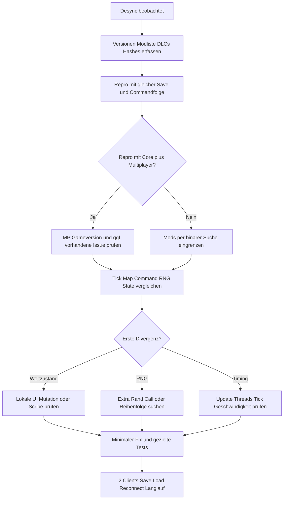

# 11 — Multiplayer-Desync: Diagnose-Runbook

**Definition:** Zwei Peers haben bei derselben logischen Simulationsposition unterschiedliche replizierte World-/Map-Zustände, RNG-Positionen oder Command-Kontexte. Was die Mod intern verglichen protokolliert, hängt von Build/Debug-Flags ab. **Historischer** DesyncCheck: https://github.com/Zetrith/Multiplayer/blob/master/Source/Client/DesyncCheck.cs (**nicht aktuelle Codegarantie**). Heutige `rwmt/Multiplayer.cs` enthält `DesyncsDir`, `LogsDir`, `ReplaysDir` und Code aus `Multiplayer.Client.Desyncs`.

## Fehlerablauf

## Untersuchungsakte, Pflichtfelder

- Host-/Client-OS, Architecture, RimWorld **exakter Build**, Multiplayer Commit/Release, Prepatcher und Harmony-Builds, `packageId`s, DLCs, Modlist in Reihenfolge.
- Multiplayer-Moden: Host, dedizierter Server, Replays/Simulating und ggf. mehrere Fraktionen; Spielgeschwindigkeit/Pausing, Maps mit UniqueID, Zeitpunkt/Timer.
- Reproduktionssavestate und deterministische Abfolge: `t = n: Client B clicks toggle on map Y`; ob Client A anderes Fenster offen hatte.
- Beide Logs inklusive Stacktraces, Desync-Snapshots, ggf. `SyncInfo`/RNG-State-Hashes. **Keine privaten Spielernamen/IPs ungeprüft veröffentlichen.**
- Erste *beobachtbare* Differenz und frühestmöglicher divergierender Command. Bei Diff auf generischen Text-XML-Logs stabiles Sortier-/Canonicalize-Verfahren nutzen, transienten Dateipfad/Wallclock ignorieren.

## Ursachen nach Symptom

| Symptom | Hypothese | Nachweis |
|---|---|---|
| direkt nach Client-Klick | nicht registrierte UI-Aktion/Field | exakt ein lokaler Handler läuft, Peer-Game-State differiert |
| bei Schuss/Angriff | andere RNG-Calls, `Verb`/Burst-Harmony-Konflikt | RNG-/Stacktrace um `TryCastNextBurstShot` vergleichen |
| beim Mapwechsel | falscher `Find.CurrentMap`/MapCommand-Context | Map ID und `executingCmdMap` im MP-Command-Trace |
| nach 1000 Ticks | Cache, statischer Zustand, iterativer Fehler | State vor/nach mehreren Ticks, `Scribe`-/Reset-Pfade |
| nur Linux↔Windows | Case-Sensitive Dateipfad, Locale, Float/Runtime | OS/Locale/Dateidefs angleichen, binäre Assets |
| nach Save/Load | nicht persistierte Modfelder oder stale Cache | Scribe-Phase, Lade-/Resolvingzeitpunkte prüfen |
| mit zweitem Mod | Harmony Prefix/Transpiler-Reihenfolge | PatchOwner-Liste, A/B mit Einzelmods |
| bei Pause oder UI offen | frame-/wallclock-mutierendes Update | deterministischen Tick vs. GUI-Call erfassen |

## Codeorientierte Prüfung

1. `TickPatch.RunCmds`: `ScheduledCommand.ticks`, `mapId`, tatsächliches `TickableById`/`ExecuteCmd`.
2. `AsyncTimeComp.ExecuteCmd`: Context (`CurrentMap`, Faction, `MpContext`), event queue und Resets.
3. `SyncSerialization`: `SyncWorker` korrekte Konstruktion/Typen, stabil referenzierte Instanz.
4. Betroffenen Mod-Code durchlaufen: first write to divergent field, `System.Random`, Dictionary order, DateTime, UnityEngine.Random, statische Collections, async Jobs.
5. `ExposeData`/`Scribe`: gespeichert, neu angelegt, reset, cross-refs auf Thing/Pawn/Map.
6. Harmony: originale Funktion geskippt? Prefix/Transpiler hat IL/Stellen geändert? Ein Patch in 1.6 anders als 1.7?

## Fix-/Test-Nachweis

Mindestnachweis: Fehler im ungepatchten Build reproduziert; Fix ändert nur ermittelte Ursache; 2 Clients 1.6 mit exakt gleichem Modsatz haben reproduzierbare identische Weltstände für Originalaktion, Save/Load, Wiederbeitritt, 30min Testlauf; Singleplayer bleibt funktionsfähig; anderer Logfehler wird separat dokumentiert. Ohne tatsächlichen Lauf `NICHT_GETESTET` schreiben.

**Quellen:** https://github.com/rwmt/Multiplayer/issues ; https://github.com/rwmt/Multiplayer/blob/master/Source/Client/Patches/TickPatch.cs ; https://github.com/rwmt/Multiplayer/blob/master/Source/Client/AsyncTime/AsyncTimeComp.cs
